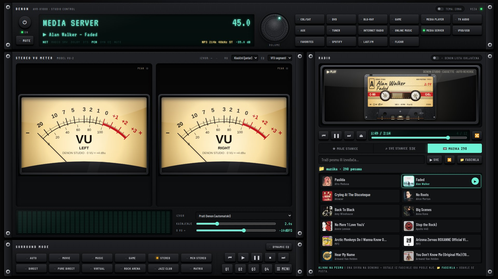

# Denon Studio

**[Srpski](#srpski) · [English](#english)**



---

## Srpski

Kontrolna tabla za **Denon AV risivere** (pravljeno i testirano na **AVR-X1000**) koja radi u browseru — izgleda kao hi-fi rack sa analognim VU metrima.
Samo Python (standardna biblioteka), ništa ne treba instalirati preko `pip`.

### Šta ume
- **Risiver:** uključi/standby, jačina (dugme), mute, svi ulazi, zvučni režimi, Dynamic EQ, Quick Select, Denon meni kao na daljinskom.
- **Analogni VU metri + ekvilajzer** — 7 izgleda (jantar, plavi, beli, zeleni, crveni, LED, VFD), prate ono što Denon svira.
- **Internet radio:** „Moje stanice” + pretraga ~50 000 stanica sa [radio-browser.info](https://www.radio-browser.info), pušta se direktno na Denonu (DLNA).
  Stanice u AAC/AAC+ formatu server u letu pretvara u MP3 (Denon preko DLNA prima samo MP3 strim).
- **Muzika sa računara (MP3, FLAC, WAV, AAC, WMA):** izabereš fasciklu, klikneš pesmu — svira na Denonu, ostale idu redom (ili nasumično).
  Umesto radija se pojavi **kasetofon sa kasetom** osvetljenom kao VU metri; na nalepnici piše izvođač i pesma, kotururi se okreću.
  Kaseta je C-90: posle 45 minuta muzike sama se okrene na **B stranu** (auto reverse). Pored nje su mehanički **brojač trake** i **LED merači nivoa**.
  Omoti albuma na spisku pesama.
- Radi i sa telefona: `http://<IP-računara>:8766`.

### Potrebno
- Python 3.8+
- `ffmpeg` / `ffprobe` (pretvaranje AAC stanica, trajanje i omoti pesama) — `sudo apt install ffmpeg`
- Chromium ili Google Chrome (za režim „aplikacije”, nije obavezno)
- Denon risiver na istoj mreži, sa uključenim mrežnim upravljanjem (*Network Control: Always On*)
- Opciono: [YTuner](https://github.com/coffeegreg/YTuner) — da „Moje stanice” budu i u Denonovom meniju Internet Radio

### Pokretanje
```bash
git clone https://github.com/serbianspeed/denon-studio.git
cd denon-studio
./denon-studio-app.sh        # otvori kao aplikaciju (prozor); kad ga zatvoriš, zaustavi muziku i server
# ili
python3 denon-studio.py      # pa otvori http://localhost:8766
```
Risiver se **sam pronalazi na mreži** (UPnP/SSDP) i IP se pamti. Ako ne uspe, upiši ga ručno u
`~/.config/denon-studio/config.json`:
```json
{ "denon_ip": "192.168.1.50", "port": 8766, "ytuner_dir": "~/YTuner/ytuner-1.2.6-x86_64-linux" }
```
ili pokreni sa `DENON_IP=192.168.1.50 python3 denon-studio.py`.

> Server sluša na celoj lokalnoj mreži (port 8766) da bi Denon mogao da povuče strimove i pesme — ne otvaraj taj port ka internetu.

---

## English

A browser control panel for **Denon AV receivers** (built and tested on the **AVR-X1000**), styled as a hi-fi rack with analogue VU meters.
Plain Python (standard library only) — nothing to `pip install`.

### Features
- **Receiver:** power, volume knob, mute, all inputs, surround modes, Dynamic EQ, Quick Select, on-screen Denon menu like the remote.
- **Analogue VU meters + spectrum** in 7 styles, following whatever the Denon plays.
- **Internet radio:** your own list + search of ~50k stations from [radio-browser.info](https://www.radio-browser.info), played on the receiver over DLNA.
  AAC/AAC+ stations are converted to MP3 on the fly (the receiver only takes MP3 live streams over DLNA).
- **Local music (MP3, FLAC, WAV, AAC, WMA):** pick a folder, click a song — it plays on the Denon, the rest of the folder follows (or shuffled).
  The radio display rolls up into a **cassette deck**: the tape is lit like the VU meters, artist and title are handwritten on the label, the reels turn as the song plays.
  It is a C-90: after 45 minutes of music it flips over to **side B** (auto reverse); a mechanical **tape counter** and **LED peak meters** sit beside it.
  Album art in the song list.
- Works from a phone too: `http://<computer-IP>:8766`.

### Requirements
Python 3.8+, `ffmpeg`/`ffprobe`, optionally Chromium/Chrome for the app window, a Denon receiver on the same LAN with *Network Control* enabled,
optionally [YTuner](https://github.com/coffeegreg/YTuner).

### Run
```bash
./denon-studio-app.sh       # app window; closing it stops the music and the server
python3 denon-studio.py     # then open http://localhost:8766
```
The receiver is **discovered automatically** (UPnP/SSDP) and remembered; otherwise set `denon_ip` in
`~/.config/denon-studio/config.json` or start with `DENON_IP=… python3 denon-studio.py`.

> The server listens on the LAN (port 8766) so the receiver can fetch streams and songs — do not expose it to the internet.

---
*Denon is a trademark of its owner; this is an independent hobby project, not affiliated with Denon / Sound United.*
